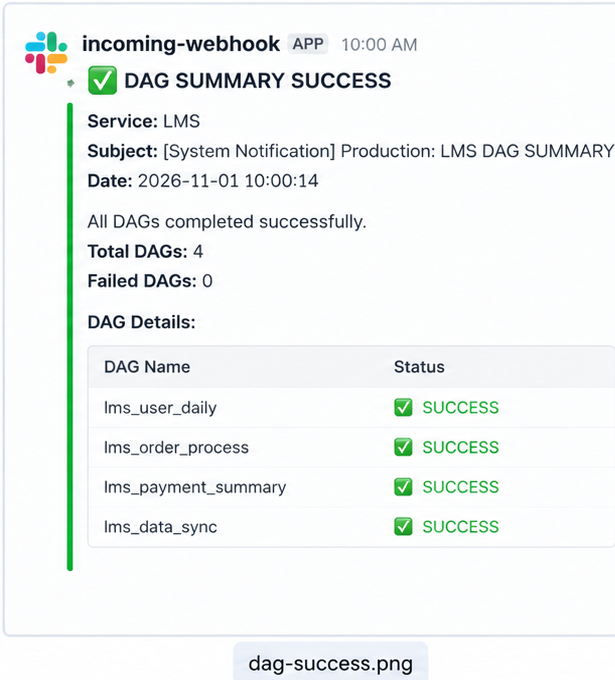
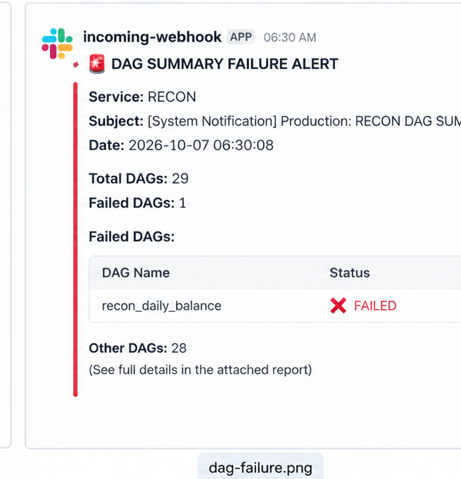
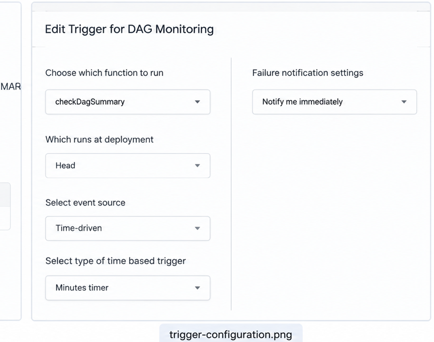

# Automated DAG Monitoring & Slack Alerting System

An automated DAG monitoring and alerting solution built using Google Apps Script, Gmail, and Slack Incoming Webhooks. The system monitors workflow execution summary emails, identifies failures and unexpected statuses, and sends structured notifications to Slack.

---

## Project Overview

This project automates the monitoring of scheduled DAG (Directed Acyclic Graph) jobs by processing summary emails received in Gmail.

Google Apps Script periodically checks incoming emails, extracts DAG execution statuses, classifies execution results, and sends notifications to a configured Slack channel.

The monitoring script runs automatically every **15 minutes** using Google Apps Script time-driven triggers.

## Architecture

```text
             Gmail Inbox
                  |
                  |
                  v
        Google Apps Script
          Time-driven Trigger
            (15 Minutes)
                  |
                  v
          Email Processing
                  |
                  v
          HTML Table Parsing
                  |
                  v
          DAG Status Validation
                  |
          +-------+-------+
          |       |       |
          v       v       v
       SUCCESS FAILURE ANOMALY
          |       |       |
          +-------+-------+
                  |
                  v
          Slack Webhook API
                  |
                  v
          Slack Notifications
```

## Key Features

- Automated Gmail monitoring for DAG summary emails.
- Supports multiple services such as LMS and RECON.
- Extracts DAG names and execution statuses from HTML email tables.
- Identifies failed DAG executions.
- Detects unexpected statuses and data anomalies.
- Sends structured Slack notifications.
- Supports success, failure, and anomaly alert categories.
- Prevents duplicate processing using Gmail message IDs.
- Maintains processed-message tracking using Google Apps Script Properties.
- Executes automatically every 15 minutes.
- Logs execution details for troubleshooting and operational visibility.

## Technology Stack

| Component | Technology |
|---|---|
| Automation | Google Apps Script |
| Programming Language | JavaScript |
| Email Integration | GmailApp |
| HTTP Requests | UrlFetchApp |
| Notification Platform | Slack |
| Alert Integration | Slack Incoming Webhooks |
| Scheduling | Time-driven Triggers |
| State Management | PropertiesService |
| Version Control | Git and GitHub |

## Notification Examples

### 1. DAG Success Notification

Displays a successful DAG execution summary.



### 2. DAG Failure Alert

Highlights failed DAG executions and provides operational visibility.



### 3. Automated Trigger Configuration

Shows the scheduled Google Apps Script monitoring configuration.



*Note: Screenshots are fictional demonstration mockups created for portfolio documentation. They do not contain actual company or production data.*

## Project Structure

```text
automated-dag-monitoring-slack-alerting/
│
├── Code.gs
│
├── README.md
│
├── .gitignore
│
└── screenshots/
    ├── dag-success.png
    ├── dag-failure.png
    └── trigger-configuration.png
```

## How It Works

### 1. Gmail Monitoring

Google Apps Script searches Gmail for recent emails containing DAG summary information.

### 2. Email Parsing

The script extracts HTML table rows and identifies:

- DAG Name
- Execution Status
- Total DAG Count

### 3. Status Classification

Each DAG execution is classified into the following categories:

| Status | Description |
|---|---|
| SUCCESS | DAG execution completed successfully |
| FAILED | DAG execution failed |
| N/A | Missing or unavailable status |
| UNKNOWN | Unexpected execution status |

### 4. Slack Alerting

The script sends structured notifications through Slack Incoming Webhooks.

Three notification scenarios are supported:

- Success: All DAGs completed successfully.
- Failure: One or more DAGs failed.
- Data Anomaly: Unexpected execution statuses detected.

### 5. Duplicate Prevention

Google Apps Script Properties stores processed Gmail message IDs to prevent the same email from being processed repeatedly.

### 6. Automated Scheduling

A time-driven trigger executes the monitoring function every 15 minutes without requiring manual execution.

## Setup Instructions

### Prerequisites

- Google account with Gmail access.
- Google Apps Script project.
- Slack workspace.
- Slack Incoming Webhook URL.

### Step 1: Create Google Apps Script Project

1. Visit https://script.google.com/
2. Create a new project.
3. Create a script file named `Code.gs`.
4. Copy the project source code into the script editor.

### Step 2: Configure Slack Webhook

1. Create a Slack Incoming Webhook.
2. Copy the webhook URL.
3. Open Google Apps Script Project Settings.
4. Navigate to Script Properties.
5. Add the following property:

| Property | Value |
|---|---|
| SLACK_WEBHOOK_URL | Your Slack Webhook URL |

Never commit actual webhook URLs or credentials to GitHub.

### Step 3: Configure Gmail Permissions

Authorize the Google Apps Script project to access Gmail and send HTTP requests.

### Step 4: Configure Time-driven Trigger

1. Open Google Apps Script.
2. Navigate to Triggers.
3. Add a new trigger.
4. Select function: `checkDagSummary`.
5. Select event source: Time-driven.
6. Select trigger type: Minutes timer.
7. Select interval: Every 15 minutes.
8. Save the trigger.

### Step 5: Execute and Verify

1. Run `checkDagSummary` manually for initial testing.
2. Check the execution logs.
3. Verify that Slack receives the expected notification.
4. Confirm that subsequent scheduled executions work correctly.

## Configuration

The project uses Google Apps Script Properties for configuration and execution state.

| Property | Purpose |
|---|---|
| SLACK_WEBHOOK_URL | Stores the Slack Incoming Webhook URL |
| PROCESSED_MESSAGE_IDS | Tracks processed Gmail message IDs |

`SLACK_WEBHOOK_URL` must be configured manually. `PROCESSED_MESSAGE_IDS` is maintained by the script.

## Logging and Troubleshooting

The script logs:

- Email subject.
- Service type.
- Total DAG count.
- Failed DAG count.
- Anomaly count.
- Slack HTTP response code.
- Number of newly processed emails.

These logs help troubleshoot email processing and notification delivery.

## Future Enhancements

- Implement retry mechanisms for unsuccessful Slack notifications.
- Add Slack webhook delivery failure handling.
- Improve Gmail search filtering.
- Add monitoring for Apps Script execution failures.
- Introduce historical DAG execution reporting.
- Add execution metrics and dashboard visualization.
- Support additional workflow services.

## Author

**Niteesh Kumar Patel**

Site Reliability Engineer | DevOps | Monitoring | Automation | Observability